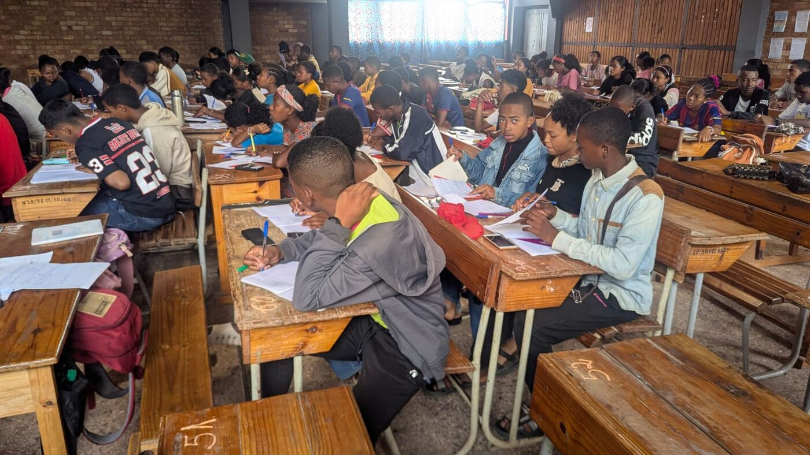
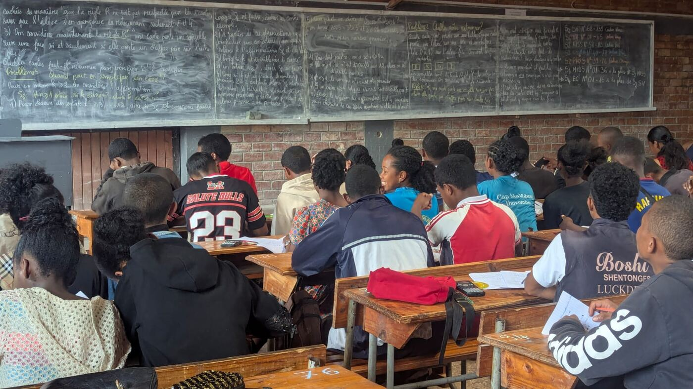
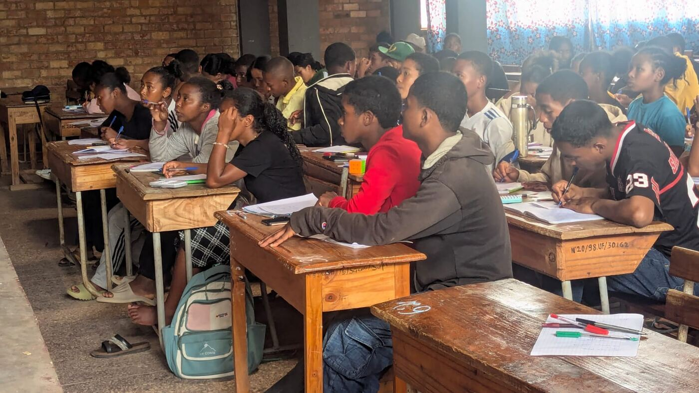
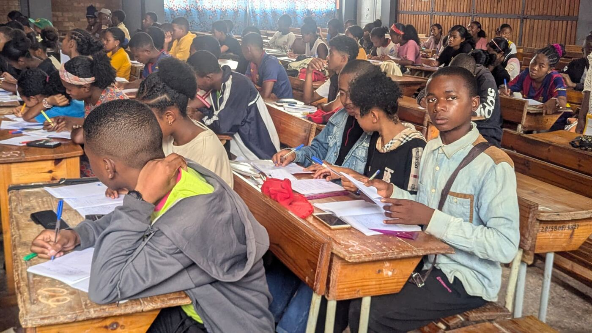
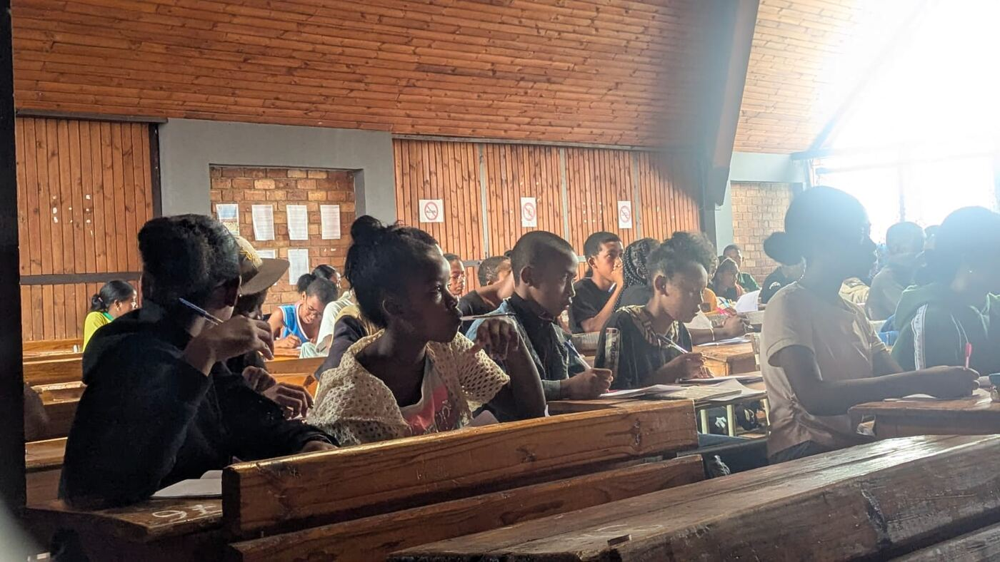
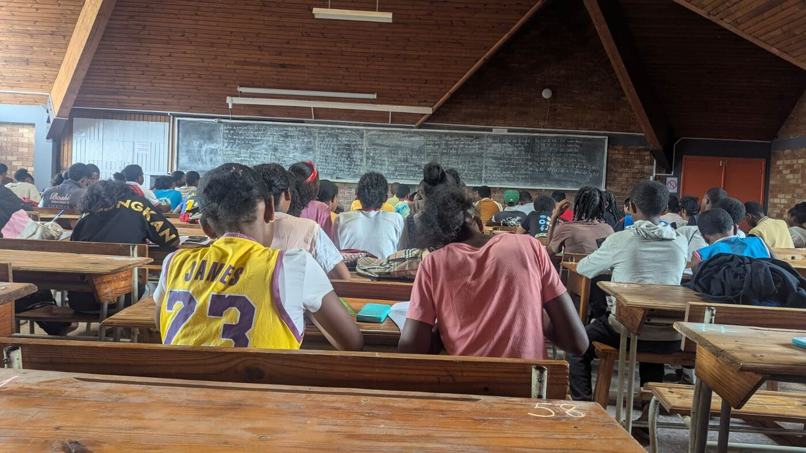

A Saturday morning, a big hall, wooden benches… and not a single free
seat. On **Saturday 14 November 2026**, **Fianarantsoa** held a new
training session, and the picture says it all.

## A blackboard full of questions

One look at the blackboard tells you the spirit of the day. No ready-made
recipes: **questions**.

> **Problem 2 — Which cards should you turn over?** Four cards lie on the
> table: **E**, **K**, **4** and **7**. Each has a letter on one side and a
> digit on the other. Which cards must you turn over to check the rule:
> *"if a card has a vowel on one side, it has an even digit on the other"*?

> **Problem 3 — When can you simplify a square?** If *k* divides *n*²,
> must *k* divide *n*? For *k* = 2, 3, …, 12, true or false? And when
> it is false, **find a counterexample**. Then: what about *k* = 2025 and
> *k* = 2026?

Guess, test on examples, then look for the **counterexample** that brings
everything down: that is exactly the spirit of the first chapter of the
course, [Examples and counterexamples](/en/courses/00-exemples-contre-exemples/).
Want to try too? Grab a sheet of paper before looking anywhere else… then
head to [Training](/en/training/contre-exemples/).

## Motivated students

Eyes on the board, chin in hand, a pen that stops and starts again: they
search, get it wrong, and try again.

## Passionate coaches

Behind every problem on the board are **passionate coaches**, eager to pass
on their passion: picking the right question, letting students search,
nudging at the right moment, and showing that a well-understood mistake is
often worth more than a copied right answer.

## Fianarantsoa is not alone

Everywhere, the centres are at work. After a
[first session on 24 October](/en/news/premier-regroupement-fianarantsoa-octobre-2026/),
Fianarantsoa keeps up the pace, alongside
[Antananarivo](/en/news/regroupements-antananarivo-novembre-2026/),
[Antsiranana](/en/news/regroupements-antsiranana-octobre-2026/) and
[Ambatondrazaka](/en/news/premier-regroupement-ambatondrazaka-octobre-2026/).

From one centre to the next, the same drive: **searching together**. Well
done to the students, thanks to the coaches, and see you at the next
session!
