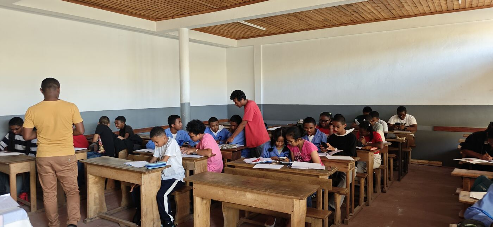
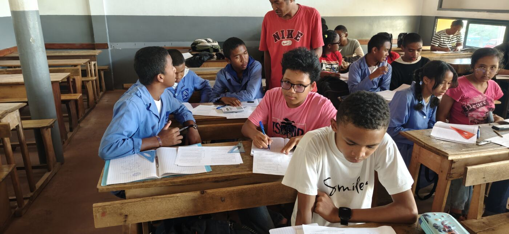
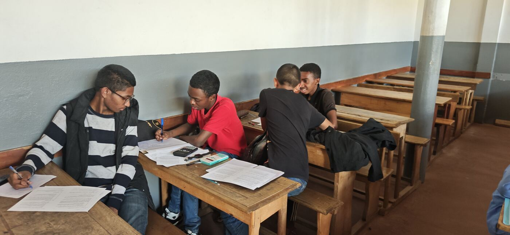
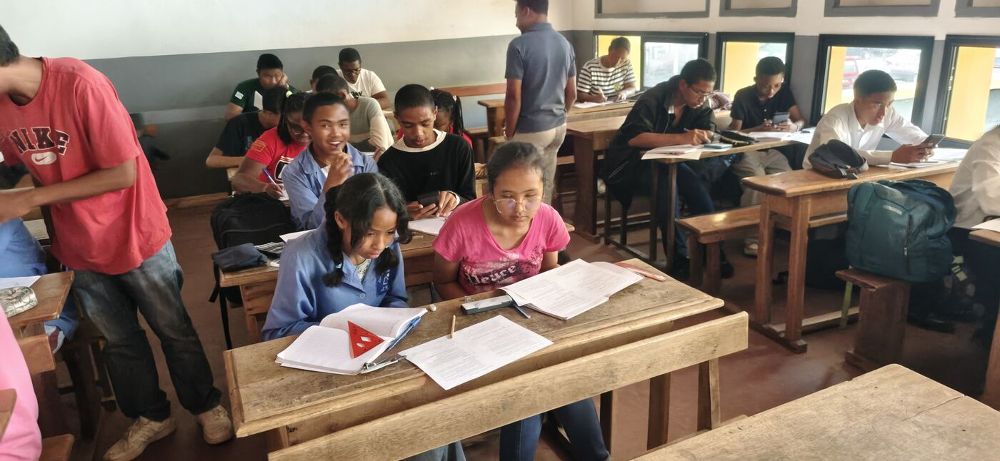
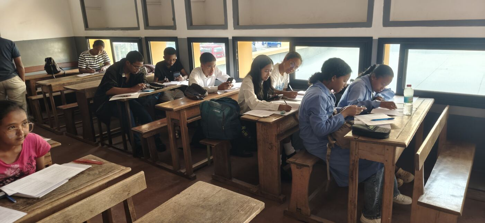
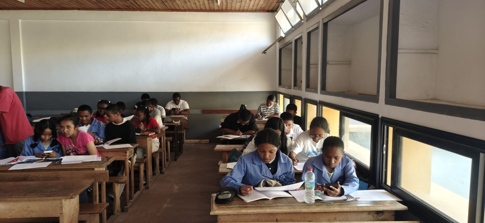

As planned, **Antananarivo** has started its sessions. And we began with the
most important notion of all: **conjecturing, examples and counterexamples**.

## First things first

Before proving, you have to learn to **guess**: compute a few cases, spot a
pattern, state a conjecture… then look for the **counterexample** that
could bring it all down. This is the first chapter of the course,
[Examples and counterexamples](/en/courses/00-exemples-contre-exemples/),
and you can practise it in [Training](/en/training/contre-exemples/).

## Two new schools

Two new schools have joined the team: **Lycée SFX Antanimena** and
**Lycée privé Idealy Soa**.

Schools and candidates from previous years answered the call, and new
recruits came from several schools: **LJF**, **St Michel**, **LJJR** and,
of course, the **LMA**.

## Same meeting place

The meeting place is the same as in previous years: the **LMA**.

## What's next?

Many new things and challenges still lie ahead this year. After
[Antsiranana](/en/news/regroupements-antsiranana-octobre-2026/),
[Fianarantsoa](/en/news/premier-regroupement-fianarantsoa-octobre-2026/)
and [Ambatondrazaka](/en/news/premier-regroupement-ambatondrazaka-octobre-2026/),
it is Antananarivo's turn. **Good luck to everyone!**
