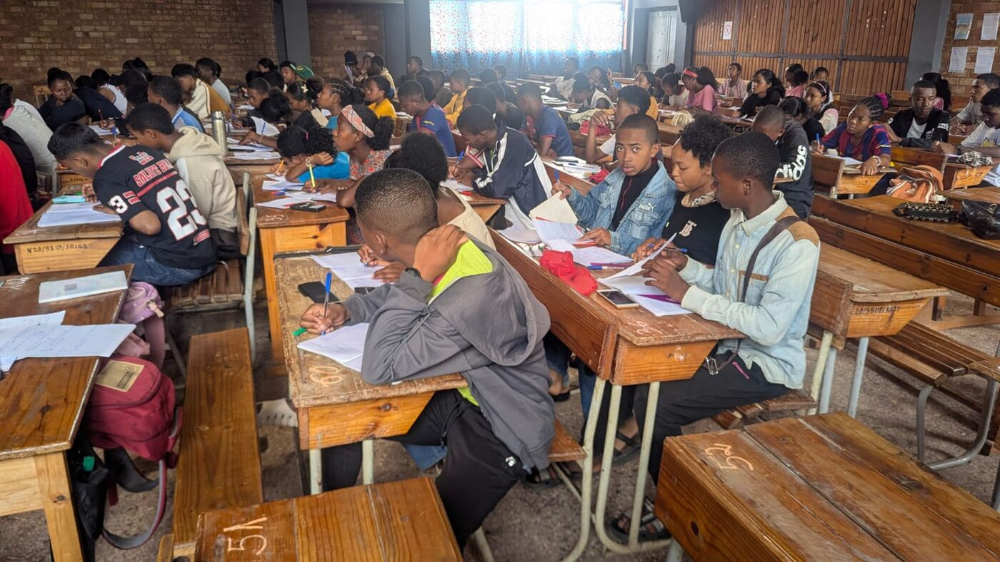
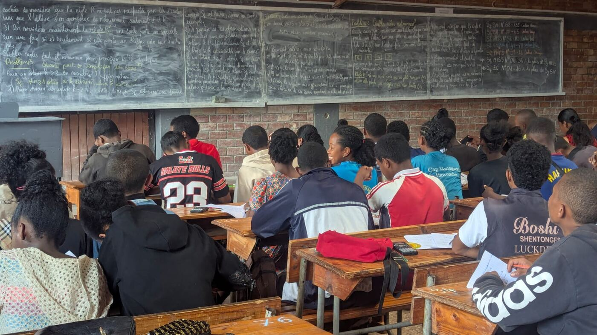
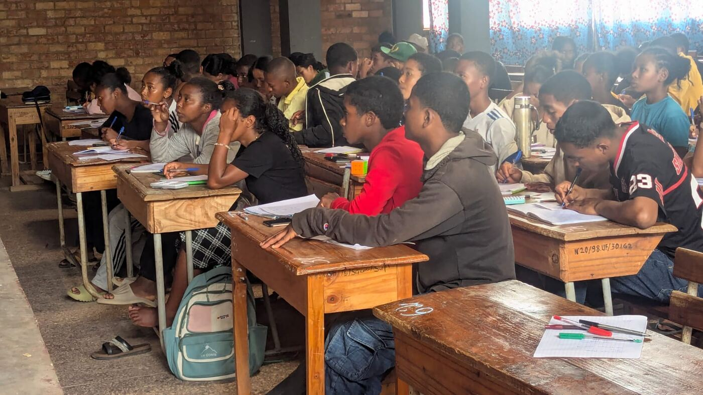
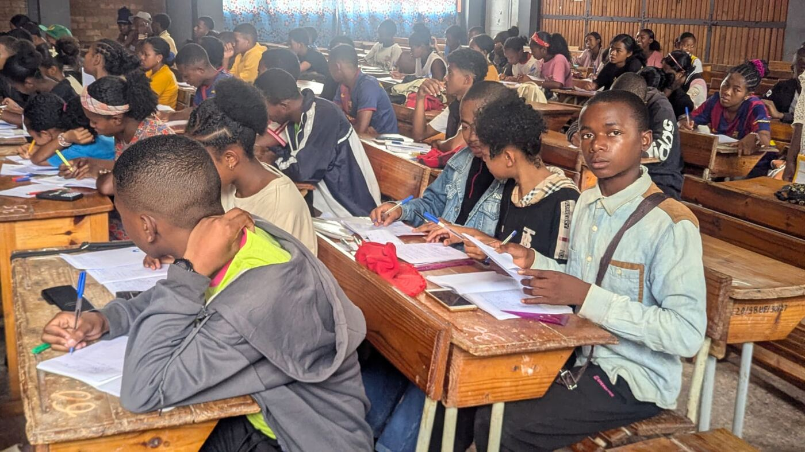
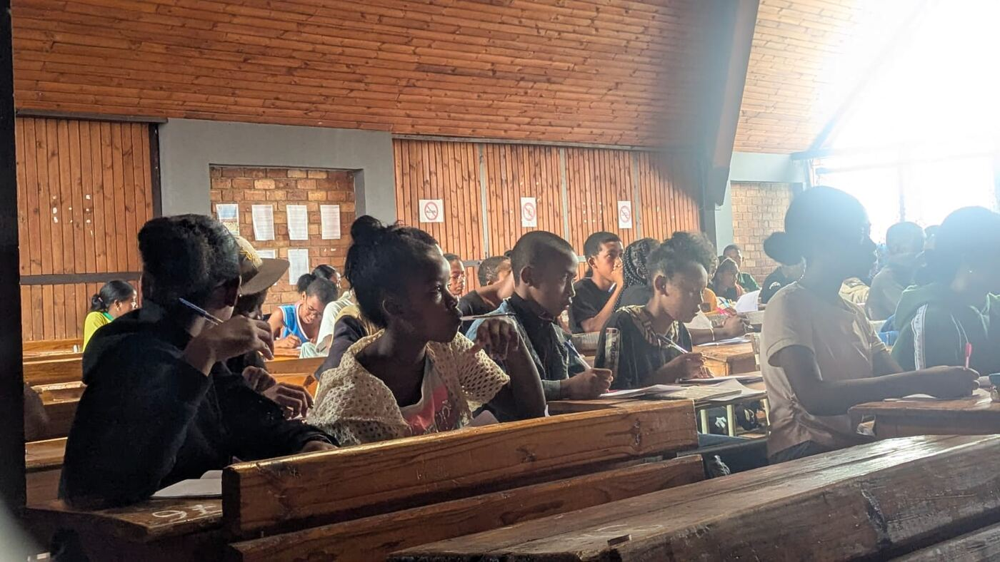
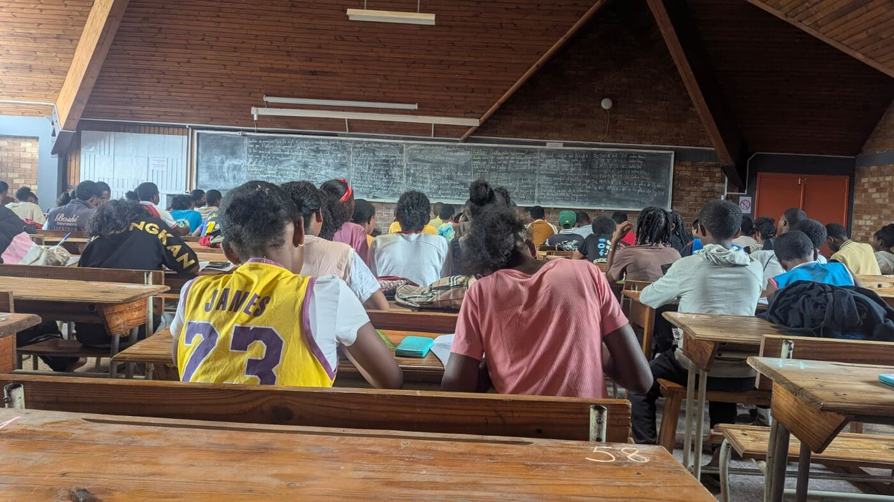

Un samedi matin, une grande salle, des bancs en bois… et plus une place de
libre. Le **samedi 14 novembre 2026**, **Fianarantsoa** a tenu un nouveau
regroupement, et la photo parle d'elle-même.

## Un tableau qui pose des questions

Il suffit de lever les yeux vers le tableau pour comprendre l'esprit de la
journée. Pas de recettes toutes faites : des **questions**.

> **Problème 2 — Quelles cartes retourner ?** Quatre cartes sont posées sur
> la table : **E**, **K**, **4** et **7**. Chacune porte une lettre sur une
> face et un chiffre sur l'autre. Quelles cartes faut-il retourner pour
> vérifier la règle : *« si une carte porte une voyelle sur une face, elle
> porte un chiffre pair sur l'autre »* ?

> **Problème 3 — Quand peut-on simplifier un carré ?** Si *k* divise *n*²,
> est-ce que *k* divise forcément *n* ? Pour *k* = 2, 3, …, 12, vrai ou
> faux ? Et quand c'est faux, **trouver un contre-exemple**. Puis : que dire
> de *k* = 2025 et de *k* = 2026 ?

Deviner, tester sur des exemples, puis chercher le **contre-exemple** qui
fait tout tomber : c'est exactement l'esprit du premier chapitre du cours,
[Exemples et contre-exemples](/fr/cours/00-exemples-contre-exemples/).
Vous voulez essayer vous aussi ? Prenez une feuille avant de regarder
ailleurs… puis passez à l'[Entraînement](/fr/entrainement/contre-exemples/).

## Des élèves motivés

Le regard fixé sur le tableau, le menton dans la main, le stylo qui
s'arrête puis repart : on cherche, on se trompe, on recommence.

## Des encadreurs passionnés

Derrière chaque problème au tableau, il y a des **encadreurs passionnés**,
prêts à transmettre leur passion : choisir la bonne question, laisser
chercher, relancer au bon moment, et faire découvrir qu'une erreur bien
comprise vaut souvent plus qu'une bonne réponse recopiée.

## Fianarantsoa n'est pas seul

Partout, les centres sont au travail. Après un
[premier regroupement le 24 octobre](/fr/actualites/premier-regroupement-fianarantsoa-octobre-2026/),
Fianarantsoa continue sur sa lancée, aux côtés
d'[Antananarivo](/fr/actualites/regroupements-antananarivo-novembre-2026/),
d'[Antsiranana](/fr/actualites/regroupements-antsiranana-octobre-2026/) et
d'[Ambatondrazaka](/fr/actualites/premier-regroupement-ambatondrazaka-octobre-2026/).

D'un centre à l'autre, la même envie : **chercher ensemble**. Bravo aux
élèves, merci aux encadreurs, et rendez-vous au prochain regroupement !
