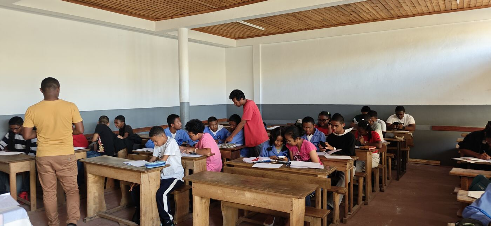
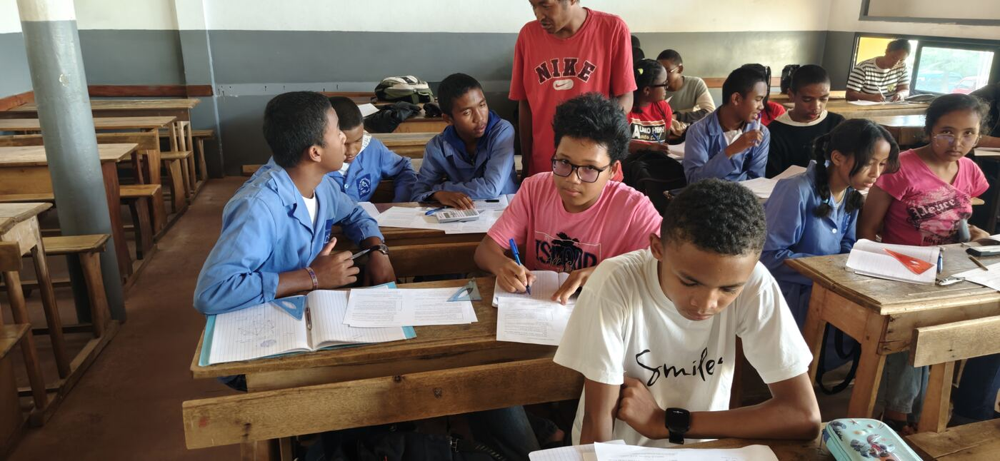
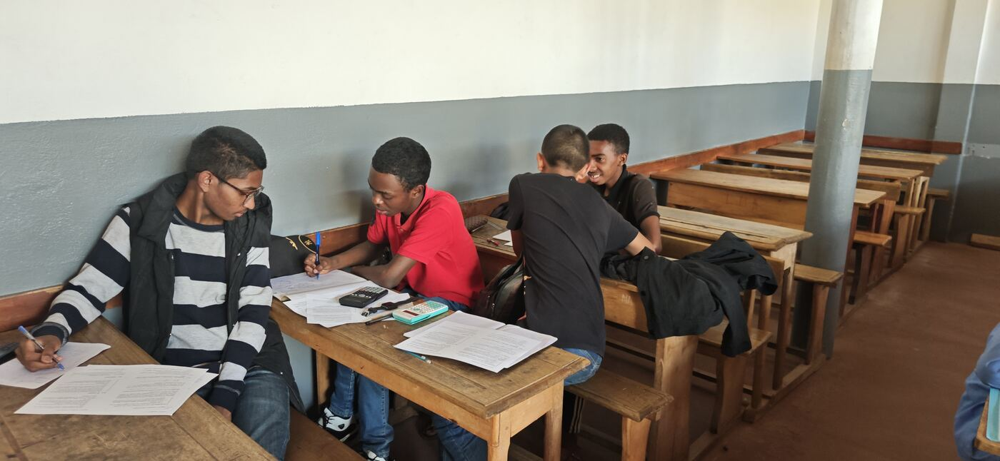
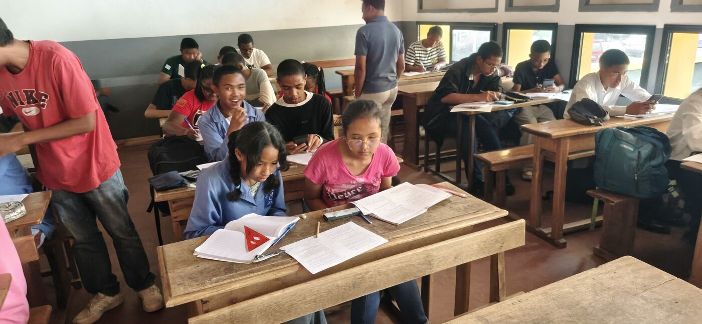
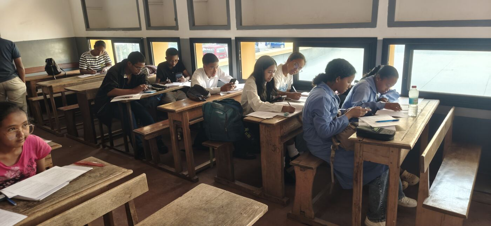
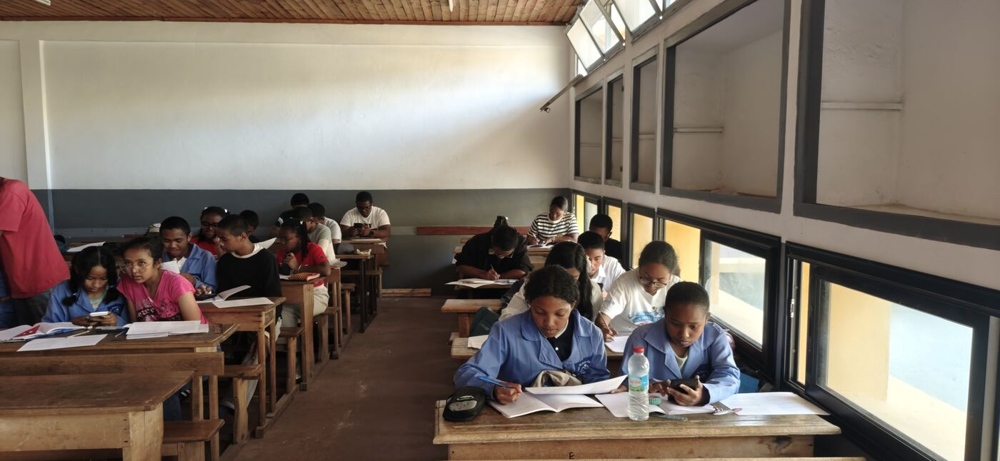

Comme prévu, **Antananarivo** a bel et bien commencé ses regroupements. Et
l'on a commencé par la notion la plus importante :
**conjecturer, exemples et contre-exemples**.

## Commencer par le commencement

Avant de démontrer, il faut savoir **deviner** : calculer quelques cas,
repérer une régularité, formuler une conjecture… puis chercher le
**contre-exemple** qui pourrait tout faire tomber. C'est le premier chapitre
du cours, [Exemples et contre-exemples](/fr/cours/00-exemples-contre-exemples/),
et on peut s'y entraîner dans
l'[Entraînement](/fr/entrainement/contre-exemples/).

## Deux nouveaux établissements

Deux nouveaux établissements ont rejoint l'équipe : le **Lycée SFX
Antanimena** et le **Lycée privé Idealy Soa**.

Les établissements et les candidats des années précédentes ont bien
répondu présent, et de nouvelles recrues sont venues de plusieurs
établissements : **LJF**, **St Michel**, **LJJR** et, bien sûr, le **LMA**.

## Même point de rendez-vous

Le rendez-vous reste le même que les années précédentes : le **LMA**.

## Et maintenant ?

Beaucoup de nouveautés et de défis nous attendent encore cette année.
Après [Antsiranana](/fr/actualites/regroupements-antsiranana-octobre-2026/),
[Fianarantsoa](/fr/actualites/premier-regroupement-fianarantsoa-octobre-2026/)
et [Ambatondrazaka](/fr/actualites/premier-regroupement-ambatondrazaka-octobre-2026/),
c'est au tour d'Antananarivo. **Bon courage à toutes et à tous !**
